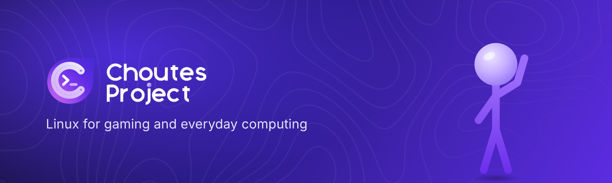
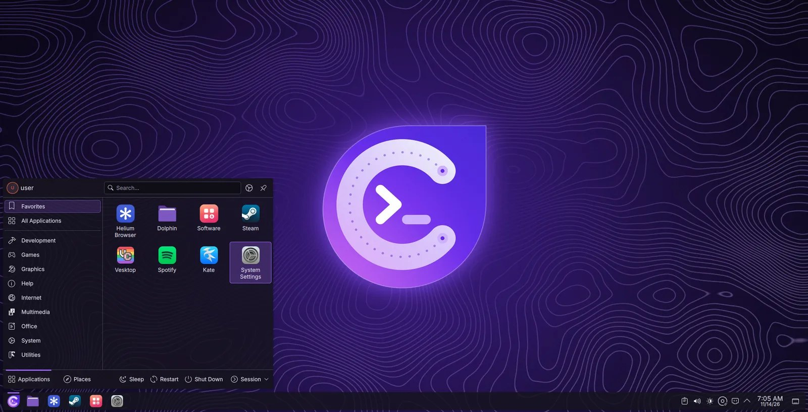
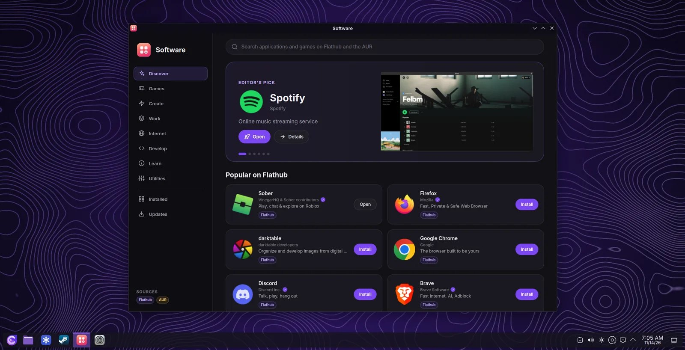
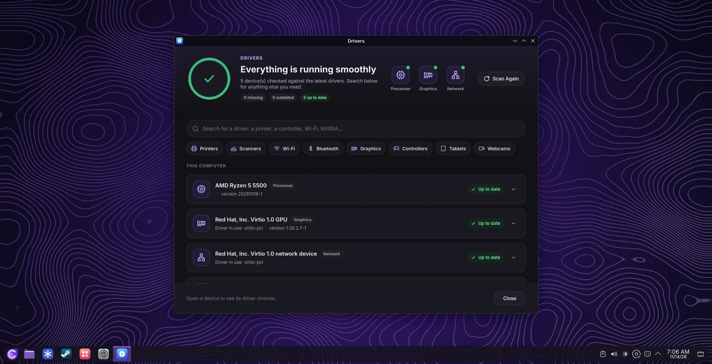
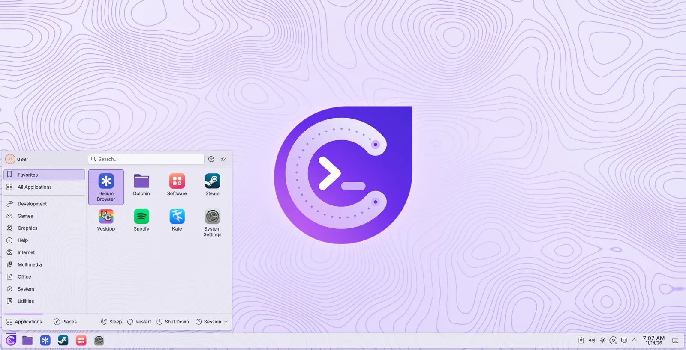
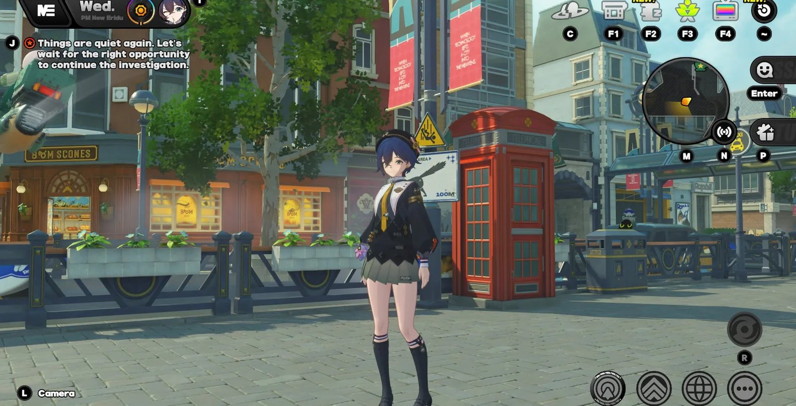
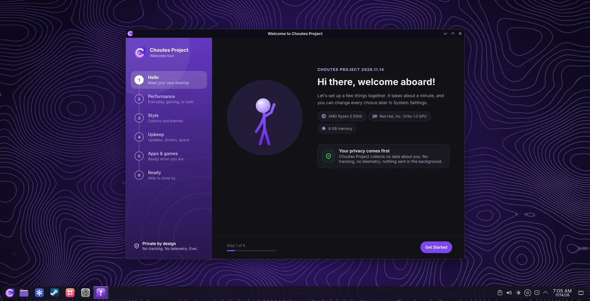
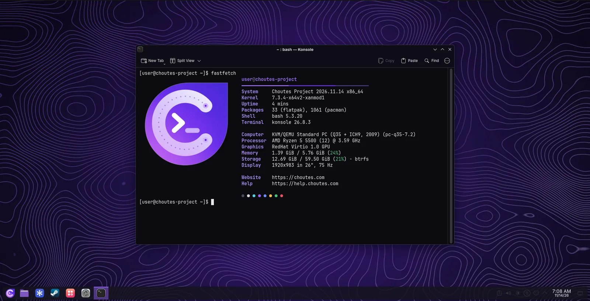
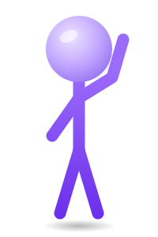

  

  <a href="https://choutes.com/download.html"><b>Download</b></a> &nbsp;&middot;&nbsp;
  <a href="https://help.choutes.com"><b>Help Center</b></a> &nbsp;&middot;&nbsp;
  <a href="https://discord.gg/nYdsKv7Fra"><b>Discord</b></a> &nbsp;&middot;&nbsp;
  <a href="https://sociabuzz.com/choutesproject/tribe"><b>Donate</b></a>

  
  
  

## What is Choutes Project?

**Choutes Project** is an operating system for desktop and laptop computers, made for gaming and everyday computing. It is built on Arch Linux, with a KDE Plasma desktop of its own, and comes with the drivers, Steam, and the applications most people need, ready from the first start. It is free to download and use.

  

## Highlights

| | |
| --- | --- |
| **An installer that works offline** | Every application and the multimedia codecs are on the installation medium. Go online first to get the newest packages, or install without a connection. |
| **Software** | Thousands of applications and games from Flathub and the AUR, and the updates of the whole system in one place. |
| **Drivers** | Finds the drivers for graphics, network, sound, printers, and game controllers, including the NVIDIA driver, and installs them in one click. |
| **Made for games** | Steam and Proton run Windows games out of the box. Gaming mode turns on by itself when a game starts, and the XanMod kernel keeps the system responsive, with the LTS kernel as a fallback. |
| **Updates you can trust** | Every package of Choutes Project is signed. On Btrfs, a snapshot is saved before and after every system update, and every new KDE Plasma version is tested before it reaches your computer. |
| **Reset System** | Puts the computer back to a fresh, up-to-date Choutes Project, as it was right after the installation. |
| **Welcome and Cleaner** | Welcome walks you through drivers, updates, and apps after the first login; Cleaner removes old packages, caches, and logs once a week by itself. |
| **A desktop of its own** | Light or dark with the accent colour you like: the panel, the folders, the login screen, the boot screen, and the apps follow along. |

<table>
  <tr>
    <td></td>
    <td></td>
  </tr>
  <tr>
    <td></td>
    <td></td>
  </tr>
  <tr>
    <td></td>
    <td></td>
  </tr>
</table>

## Download

Download Choutes Project only from **[choutes.com](https://choutes.com/download.html)**. The download page shows the size and the SHA-256 checksum of the image; the [Help Center](https://help.choutes.com/download.html) explains how to check it and how to [create a USB installation drive](https://help.choutes.com/usb.html).

The [release notes](https://github.com/Choutes-Project/Choutes-Project/releases/latest) list what is new in each version. A new version arrives on installed computers as a normal update in Software: there is no need to download or install Choutes Project again.

## System requirements

| | Minimum | Recommended |
| --- | --- | --- |
| Processor | 64-bit (x86-64) | x86-64-v2 or newer: Intel Core i5 8th generation, AMD Ryzen 5 2000 series, or newer |
| Memory | 4 GB | 8 GB or more |
| Storage | 40 GB | 120 GB or more on an SSD |
| Graphics | OpenGL 3.3 | Vulkan 1.3: AMD Radeon RX 400, Intel Iris Xe or Arc, NVIDIA GeForce 16 series, or newer |
| Firmware | UEFI or BIOS, Secure Boot turned off | UEFI |
| Installation medium | USB drive of 8 GB | USB 3 drive of 8 GB or more |

More in the Help Center: [System requirements](https://help.choutes.com/system-requirements.html).

## Help and feedback

| | |
| --- | --- |
| **Questions and help** | The [Help Center](https://help.choutes.com) and the [Discord server](https://discord.gg/nYdsKv7Fra) |
| **Bug reports** | [Report a problem](https://github.com/Choutes-Project/Choutes-Project/issues/new?template=bug_report.yml) |
| **Suggestions** | [Suggest an idea](https://github.com/Choutes-Project/Choutes-Project/issues/new?template=suggestion.yml) |
| **Security problems** | Report them privately, as described in the [security policy](https://github.com/Choutes-Project/.github/blob/main/SECURITY.md) |
| **Contact** | [admin@choutes.com](mailto:admin@choutes.com) |

## Support Choutes Project

Choutes Project is an independent project. Donations go to its development: more time for new features and fixes, and testing on more hardware. [Donate through Sociabuzz](https://sociabuzz.com/choutesproject/tribe), or help other users on the [Discord server](https://discord.gg/nYdsKv7Fra) and tell your friends about Choutes Project.

## Repositories

| Repository | Contents |
| --- | --- |
| [packages](https://github.com/Choutes-Project/packages) | The signed pacman repository of Choutes Project, also at [packages.choutes.com](https://packages.choutes.com) |
| [.github](https://github.com/Choutes-Project/.github) | Brand assets and the default community files |

## License

Every program in Choutes Project keeps the licence of its authors; the Linux kernel, for example, is licensed under the GNU GPL version 2. The packages made by Choutes Project are licensed under the GNU General Public License, version 3 or later. The Choutes Project name, logo, and artwork are not covered by that licence. Read the [Terms of Use](https://choutes.com/terms.html) for the details.

---

&copy; 2026 Choutes Project. The Choutes Project name, its logo, and its stick figure are trademarks of Choutes Project. 
Linux&reg; is the registered trademark of Linus Torvalds in the U.S. and other countries. Choutes Project is built on Arch Linux and is not affiliated with or endorsed by the Arch Linux project. KDE&reg; is a registered trademark of KDE e.V. Other names and logos belong to their owners. 
Choutes Project is free and shows no advertising; it is kept alive by donations from its users. <a href="https://choutes.com/terms.html">Terms of Use</a> &middot; <a href="https://choutes.com/privacy.html">Privacy Policy</a> &middot; <a href="https://choutes.com/cookies.html">Cookie Policy</a>
